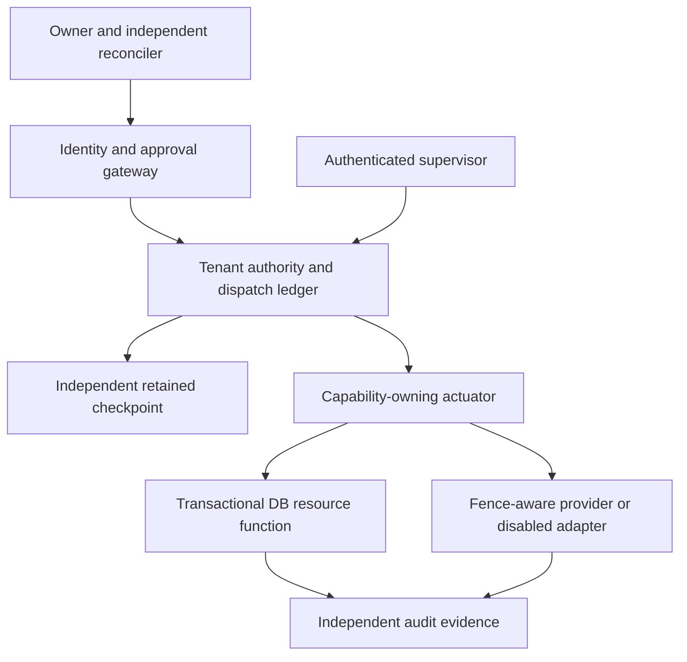

# ADR-20261029: production authority and complete mediation

Status: **PROPOSED for independent review; NOT authorization to implement, provision or deploy.** Date: 29 October 2026. Source: `45b754eb02a034fd5c13462f6157a3b4685e27f5`.

## Problem and decision

The tested prototype has signed plans/contracts, shared burned identities, synthetic external epochs and observed disposable-worker termination. The application has separate credentialed HTTP/cron paths that do not use those controls. Its local authority cannot protect itself against a host restoring its signing key and records together.

**Select a hybrid architecture for isolated staging evaluation:** a Cloudflare SQLite-backed Durable Object (DO) owns tenant authority and dispatch serialization; a separately administered retention/checkpoint service detects authority rollback; Supabase Postgres executes database-local effects in constrained atomic functions. Dedicated actuators, never agents or the general UI Worker, hold narrowly scoped provider capabilities. This is a conditional design choice, not proof of a production implementation.

Use existing service families evidenced in the repository, not assumed installed products: Workers, Hyperdrive, Workers AI, email, Supabase Auth/Postgres/Storage. DO authority namespaces, independent R2 retention/checkpoints, signing-service custody and isolated staging are **new requirements, not verified existing resources**. No live account inventory was read.

The diagram shows logical boundaries. Whether authority and actuator share one DO or use a private service binding must be settled per adapter; a binding alone does not make their transactions atomic. Staging starts with one tenant and one protected adapter to avoid claiming an untested cross-object transaction.

## Invariants and trust anchors

1. An agent has no provider secret, DB connection, service-role key, arbitrary HTTP tool, runner, authorization callback or authority admin capability. It can request typed operations only.
2. Every protected effect carries tenant, owner, task, immutable plan hash/version, approval ID, contract hash/ID, agent identity/key ID, job ID, epoch, supervisor fencing sequence, resource identity/version, adapter version, operation ID, argument digest, scope/budget and expiry. The actuator derives real target/zone/cost; it does not accept declarations as authority.
3. Tenant job/contract/agent/step claims remain consumed across expiry, crash and recovery. Approval IDs bind exact receipts; a plan-wide approval can cover distinct steps but cannot be rebound. Canonical tuple keys prevent namespace ambiguity.
4. Authority epochs and fencing sequences increase through transactional state, not local wall-clock ordering. New authority/database incarnations need externally recorded generation approval. Missing or contradictory evidence denies effects.
5. A permanent effect intent precedes dispatch. Lost acknowledgment means UNKNOWN/QUARANTINED, never “not executed.” A lease timeout does not free an identity or prove process/network termination.
6. Recovery cannot advance past an unresolved in-flight operation. Instant cancellation of an accepted remote request is not promised. An effect linearized before revocation may complete; future dispatch is denied. Stronger physical-time revocation requires the resource itself to enforce it or that adapter remains unsupported.

Trust anchors are separately managed owner/reconciler public keys, workload identity roots, authority identity and expected DO namespace/tenant mapping, checkpoint identity, database incarnation and reviewed adapter digest. A client-supplied key, JWT tenant string, URL, fallback binding or new object namespace never silently substitutes for a pin.

## Component and key custody contract

| Principal/component        | Permitted capability                                                                              | Forbidden capability                                                                              |
| -------------------------- | ------------------------------------------------------------------------------------------------- | ------------------------------------------------------------------------------------------------- |
| Owner                      | Approve exact canonical plan/recovery challenge after fresh strong authentication                 | Supply an arbitrary execution callback or approve unseen plan bytes                               |
| Reconciler                 | Independently attest termination and effect reconciliation with evidence hashes                   | Use the owner's signing credential; approve its own disputed execution                            |
| Authority                  | Verify receipts/identities; reserve claims/budgets; mint current operation grants; freeze/recover | Erase consumed identities, treat TTL expiry as reconciliation, operate from an unverified restore |
| Actuator                   | Execute fixed reviewed adapter with dedicated scope; commit intent/outcome                        | Forward arbitrary URLs/SQL/shell, follow target-changing redirects, export secrets to agents      |
| Agent/supervisor worker    | Signed requests within one contract; supervisor presents separately enrolled workload proof       | Choose trust roots, restore state, access administrative provider/DB APIs                         |
| Checkpoint/audit custodian | Retain canonical sequence keys and manifests; verify exports                                      | Execute jobs, rewrite authority state, share the authority's routine delete/config permission     |

Owner/reconciler enrollment binds stable verified subject IDs to tenant authority and public keys through an independently reviewed ceremony. Existing email comparisons and `admin` role are not plan approval. Require fresh phishing-resistant user verification for approval/recovery; WebAuthn's signed challenge must bind a server nonce and exact displayed plan/recovery hash, RP/origin and tenant. Supabase MFA/AAL can support session policy but is not by itself a signed plan receipt or a claim of phishing resistance [S8] [W1].

Retain the independently verifiable owner authenticator assertion and enrollment proof in the approval receipt. A server signing its own interpretation of an ordinary session is not independent owner intent.

Require a non-exportable signing service or hardware-backed custody for production authority/owner/reconciler keys, with separate operators, audit, rotation and emergency revocation. Workers secrets and Supabase database/Vault storage are not evidence of non-exportability. Preserve current Ed25519 verification unless an explicitly versioned algorithm/key transition is approved; do not silently substitute an unsupported algorithm. **A compatible signing provider and its cost/control proof remain undecided.** Runtime provider credentials can use scoped secret bindings, but only an actuator receives them [C8].

Workloads enroll with distinct asymmetric identities and short-lived audience-bound proof, pinned issuer, tenant and supervisor ID. A service binding or shared bearer secret alone is not an individual agent identity. Every exchange rechecks revocation and instance generation; tokens/logs are never copied into an agent environment. Rotate compromised workload/provider keys through a frozen, independently approved transition, not an automatic fallback.

## Authority transactions, checkpoints and recovery

Use one canonical tenant object ID derived on the server from a stable tenant UUID. No per-request or caller-chosen namespace. Within local DO storage transactions, atomically enforce unique burned identities, exact plan/approval bindings, budget reservations, epoch/fence checks and a monotonically numbered event. Reject conflicting receipts and concurrent duplicate claims. Bound schema/version/size before crypto work; rate-limit abusive identities.

DO storage is strongly consistent and supports local transactions, but DO storage can be restored through PITR [C1]. Therefore each authorization-changing event must be durably anchored outside that restore domain **before its grant can dispatch**:

1. Persist PREPARED event with previous hash, authority sequence, epoch, tenant, operation/claim ID and next state digest. No capability is yet usable.
2. Create the canonical external checkpoint key `(authority ID, tenant ID, sequence)` exactly once using conditional creation, with signed event bytes. Verify stored content and the latest externally retained chain head without CDN/HTTP caching. A conflicting key/head, lost response or unavailable checkpoint leaves the tenant blocked.
3. Persist CHECKPOINTED/COMMITTED locally, then release only the matching one-operation grant. A crash between steps requires reconciliation; a local row alone cannot authorize.
4. Before each authority decision/dispatch, compare the current local head with an independently obtained fresh checkpoint head. Do not cache successful freshness across subsequent decisions. Independently retain complete burned-identity history/manifest and verify it on recovery; a high-water number alone cannot reconstruct lost claims.

R2 supports strong object consistency and atomic conditional creation; bucket locks provide retention but configuration can be changed by privileged administrators [C3] [C4]. The checkpoint writer must not hold lock-removal/delete/admin capability. Use independent custodians and backup/restore controls; test cross-account permissions if chosen. There is no DO+R2 distributed transaction. The PREPARED protocol deliberately trades availability for safety. Joint compromise/rollback of authority and independent custodian remains a root-of-trust failure, not a solved property.

Recovery sequence: freeze admission and credential release; inventory processes, in-flight network requests and actuator queues; establish actual termination and provider/DB outcomes independently; preserve all records; owner and distinct reconciler sign the same current authority/checkpoint heads, from/to epoch, target resource/store incarnation and reconciliation manifest; advance exactly one epoch and invalidate old fences; restore/import all consumed identities; enroll fresh workload instances; require fresh approval/new plan version for previously used tasks. Never clear unknown operations or reuse old job IDs. A reconciliation signature verifies who asserted facts, not whether the facts are true. Unconfirmed shutdown/request completion blocks recovery of that affected execution domain.

Root authority restoration is separately governed: it must reconcile against the independent custodian before serving any command, including after a DO namespace or deployment change. A restored checkpoint namespace or replacement object ID needs explicit root re-enrollment; it cannot bootstrap itself as empty. Hard counter limits and canonical decimal/string representation avoid integer precision loss between JS and SQL.

## Effect-boundary contracts

### Database-local effect

A dedicated Postgres role may EXECUTE only narrowly scoped private functions; no agent/UI role receives table mutation, arbitrary SQL, schema ownership or BYPASSRLS. A reviewed function locks the resource-generation row, validates the exact operation/fence, tenant/subject membership, argument digest and budget, consumes the unique operation ID, mutates the resource and inserts its audit event in **one primary-database transaction**. Generation advancement takes the same lock. Set explicit search paths and EXECUTE grants; a SECURITY DEFINER function must perform its own authorization with a non-superuser narrow owner [S1] [S2] [S3].

This transaction is atomic only within that database. It cannot read a remote DO and mutate Postgres atomically. Only the protected actuator can submit the root-approved operation; DO in-flight barriers prevent an approved generation transition while it is outstanding. Postgres incarnation must match the approved root state, and an independently controlled restore procedure must isolate restored DB endpoints before reconnection. Proving that control-plane restore cannot reopen a bypass is a staging/human gate, not an asserted consequence of SQL locks.

Do not use a cached Hyperdrive connection for authority, authorization or effect checks. Require a separately verified cache-disabled path and primary semantics; current repository configuration does not prove that setting. Do not use replica/session state or a preceding ORM SELECT as the effect guard [C5]. Serialization-failure retries are permitted only for a proven-rolled-back database-local transaction under the same operation ID, with no external effect performed. Ambiguous commits require querying the operation ledger; they are not automatically resubmitted [S2].

### External HTTP, storage, model and message effects

A DO's storage transaction does not include awaited network I/O, and ordinary asynchronous handlers can interleave [C2]. Use durable dispatch state, not a long `blockConcurrencyWhile(fetch)` or an in-memory mutex. Reserve intent and checkpoint it, atomically mark one dispatch owner, invoke the fixed actuator, then retain provider acknowledgment independently. Any persisted IN_FLIGHT/UNKNOWN operation inhibits recovery; object restart, queue redelivery or HTTP timeout cannot automatically resend it.

Prefer a resource that checks the current epoch/fencing sequence and atomically consumes the operation ID at its own effect. For SQL this is the function above; for a different service it requires documented/tested provider support or an independently controlled fence-aware actuator that is the sole path to the resource. Idempotency prevents some duplication; it does not prevent stale-epoch execution. A signed URL is a bearer capability until expiry and cannot provide immediate revocation. A cloud email/AI binding alone is not a per-operation fence.

**If acceptance/termination/outcome cannot be bounded and independently reconciled, the adapter stays disabled for autonomous execution.** No exactly-once or universal instantaneous stop claim is made for arbitrary email, model inference, uploads or third-party APIs. Already-performed effects cannot be undone. Manual access must remain a separately authenticated, audited break-glass workflow, not an agent-accessible bypass.

## Alternatives and consequences

| Option                                                                        | Can enforce                                                                                    | Main gap / disposition                                                                                                                                     |
| ----------------------------------------------------------------------------- | ---------------------------------------------------------------------------------------------- | ---------------------------------------------------------------------------------------------------------------------------------------------------------- |
| Supabase-only authority and effects                                           | Claims, resource guards and DB-local effects in one transaction                                | PITR can restore counter and consumed rows together. Requires independent generation checkpoint; reject as sole rollback root.                             |
| DO-only authority/actuation                                                   | Tenant-local transactional coordination and dispatch state                                     | PITR root rollback; no atomic arbitrary HTTP effect or SQL transaction. Viable for DO-local resources with independent checkpoints; insufficient alone.    |
| Hybrid DO/checkpoint + constrained Postgres functions                         | Independent restore domains plus DB-local atomic effect guard; reuses current service families | More failure boundaries and no cross-service transaction. **Selected for staging evaluation only**, with durable uncertainty barriers.                     |
| Fully independent hardware/managed authority and fence-aware resource service | Potentially stronger custody, identity and root durability                                     | Provider selection, Ed25519/rotation support, cost and integration unverified. Required if existing services cannot pass the stated custody/restore gates. |
| Workers KV, cache, queue delivery or local files as authority                 | Useful caching/transport/test fixtures                                                         | Cannot substitute for the transactional, protected authority. Queue redelivery and stale reads do not grant work. Rejected.                                |

Consequences: more deliberate denial during partitions, retained consumed identities, nontrivial custody/retention cost and no autonomous support for unfenceable tools. Those are accepted design constraints. Detailed cost assumptions and primary sources are in [Sources and cost](../security/production-authority/SOURCES-AND-COST.md); implementation gates are in [Implementation and acceptance](../security/production-authority/IMPLEMENTATION-AND-ACCEPTANCE.md).

[C1]: https://developers.cloudflare.com/durable-objects/api/sqlite-storage-api/
[C2]: https://developers.cloudflare.com/durable-objects/best-practices/rules-of-durable-objects/
[C3]: https://developers.cloudflare.com/r2/reference/consistency/
[C4]: https://developers.cloudflare.com/r2/buckets/bucket-locks/
[C5]: https://developers.cloudflare.com/hyperdrive/concepts/query-caching/
[C8]: https://developers.cloudflare.com/workers/configuration/secrets/
[S1]: https://supabase.com/docs/guides/database/functions
[S2]: https://www.postgresql.org/docs/current/transaction-iso.html
[S3]: https://www.postgresql.org/docs/current/explicit-locking.html
[S8]: https://supabase.com/docs/guides/auth/auth-mfa
[W1]: https://www.w3.org/TR/webauthn-2/
